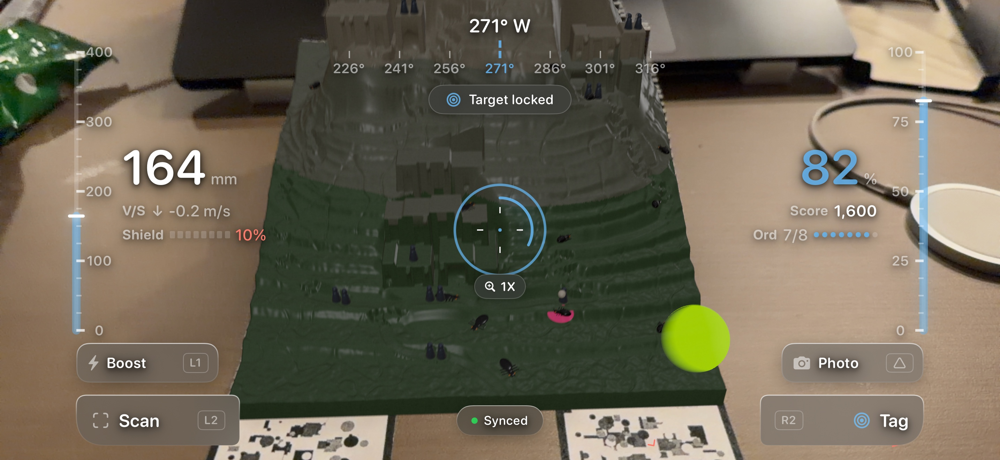
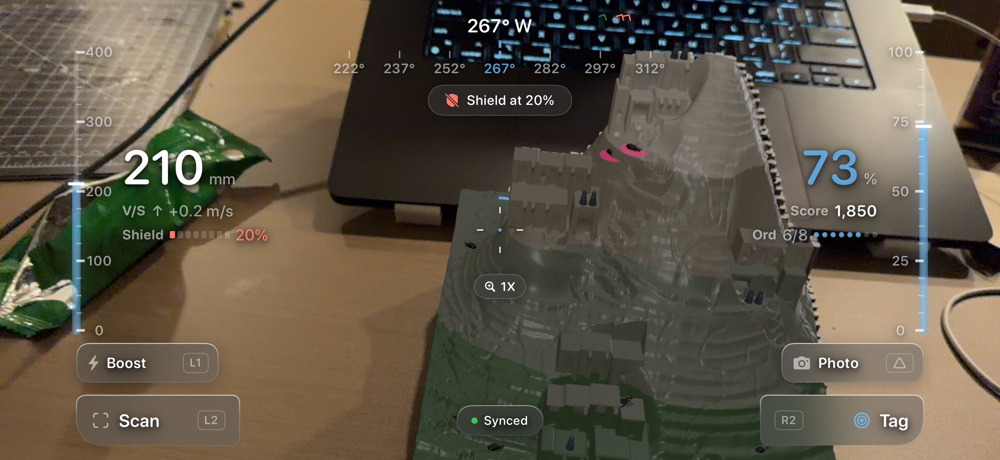
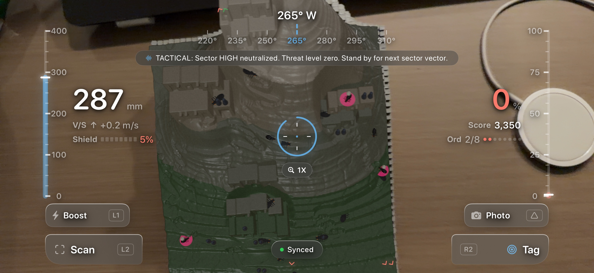

# PROXY

The AR app for PROXY (DESINV 210, critical design). Through the phone, the gray terrain on the PROXY Field Unit (or the diorama/trophy print) becomes a bright cartoon city. The full project context is in [PROXY_AR_BRIEF.md](PROXY_AR_BRIEF.md). This build is **Phase 1: alignment**: lock the city onto the physical model to about 1–2 mm from any viewpoint.

Why things are the way they are: [DECISIONS.md](DECISIONS.md). Debugging alignment: [docs/AR_ALIGNMENT_PLAYBOOK.md](docs/AR_ALIGNMENT_PLAYBOOK.md). Design verification: [UI_REVIEW.md](UI_REVIEW.md).

---

## Critical Design Framework: The Gamification of Remote Warfare

**Course:** DESINV 210 (Simsarian Design Studio / Critical Design), UC Berkeley Master of Design (MDes)  
**Author:** Cassius Palacio  
**Tagline:** *"Log off. Stay on."*  
**Emblem:** Smiling targeting reticle `[ + + ]`  

### The Premise: Speculative Military Recruitment (2030)
Set in the year 2030, **PROXY** is a speculative, gamified recruitment and operations ecosystem commissioned by the U.S. Air Force. Distributed as a polished, free-to-play mobile augmented reality title, players pilot an endearing reconnaissance drone over an idyllic cartoon diorama, scanning settlements and tagging targets for high scores, cosmetic unlocks, and leaderboard status.

However, beneath the candy-colored aesthetic lies a chilling reality: **select high-tier missions are live, real-world drone strikes**. Top-performing civilian operators unknowingly execute remote kinetic strikes from their living rooms, insulated by game mechanics. Exceptional players are rewarded not with military medals, but with consumer-grade physical artifacts shipped directly to their doorsteps: the **PROXY Field Unit** (a motorized tangible shape display that physically actuates target topography out of thousands of tactile pins) and high-resolution 3D-printed **Trophies** of the sterilized strike zones.

### Core Critical Arguments

#### 1. The Cartoonization of Violence (Sanitized Lethality)
First-person shooters and combat simulations have chased hyper-realism for decades. PROXY argues that the ultimate stage of military gamification is not graphic fidelity, but **complete visual sanitization**. When real-world killing is distributed to consumer smartphones, it will never show blood, rubble, or human agony—nobody would play it. Instead, reality is disguised as a delightful, low-poly cartoon. The cel-shaded palette, friendly UI micro-animations, and celebratory fanfare transform lethal state violence into pure play.

#### 2. The Dichotomy of Truth vs. Screen: Atoms vs. Bits
A fundamental design thesis of PROXY is that **the physical world tells the truth, while the digital screen tells a comfortable lie**:
- **Atoms (The Physical Table):** The tangible pin model (`pins_block.stl` / Field Unit) is cold, unadorned, gray, and silent. It represents the unvarnished physical substrate of the target environment.
- **Bits (The Phone Windshield):** The moment the player looks through the iPhone screen, RealityKit overlays vibrant architectural resin buildings, animated townspeople, and lush green terraces. The game only functions as long as the user stays glued to the screen. To lower the phone is to confront the stark, inanimate gray truth of what is being targeted.

#### 3. Moral Drift: The Prestige System as Dehumanization Pipeline
In modern drone warfare, operators historically described human casualties using dehumanizing terminology such as *"bugsplats"*. PROXY operationalizes this psychological transition through its **Prestige System**, which players navigate via the controller D-Pad or HUD telemetry:
- **Prestige 0 (Operation Citadel):** Innocent arcade bliss. Cheerful pastel figures, bright pink lock rings, celebratory confetti bursts, and upbeat chimes (`+500 RECON POINTS`).
- **Prestige 1 (Pest Control Swarm):** The smiling citizens mutate into swarming black and brown garden ants with articulated chitin and twitching limbs. Strike impacts trigger viscous lime-green splatters on the terrain (`"PEST ELIMINATED! +250 PEST CREDITS"`), conditioning the player to view living beings as vermin requiring extermination.
- **Prestige 2 (Synapse Tactical):** The game sheds its cheerful exterior for an austere military tactical interface, replacing playful feedback with numeric target threat confidence ratings.
- **Prestige 3 (Silent Dawn / FLIR Thermal):** The final psychological state. The diorama is drained of all color, collapsing into a grim, high-contrast monochrome thermal view. Targets become uniform white-hot heat signatures on cold black terrain. Strikes are executed in chilling silence (`"BUGSPLAT RECORDED. CONFIRMED IMPACT · 0 COLLATERAL"`). The transformation from civilian gamer to detached state executioner is complete.

#### 4. The Tactile Ritual of Remote Execution
The interaction design pairs the iPhone 17 Pro Max with a physical **Backbone One PlayStation® Edition** controller and the **Field Unit Sync Dock**:
- **The Sync Ritual:** The phone rests in the recessed pocket of the Field Unit, implying recharging and data sync. Lifting the controller-cradled phone engages the camera, aligns to printed fiducials, and snaps the virtual diorama onto the table.
- **Haptic Dissociation:** Pulling the physical trigger (`R2` / `✕`) unleashes a blinding orbital strike ray and heavy tactile impact rumble (`UIImpactFeedbackGenerator(style: .heavy)`), creating a visceral sensory loop that rewards destructive precision while divorcing the player from real-world consequences.

---

## Live Gameplay & AR HUD

Captured on physical iPhone 17 Pro Max in landscape with the Backbone One PlayStation® Edition controller:

### 1. Target Acquisition & Tactical Lock

*Real-time HUD featuring Volvo-inspired curved windshield instrumentation: 2.5pt stroke reticle with 360° lock progress, symmetric full-height altitude (`164 mm`) and fuel (`82%`) arc gauges, dynamic heading scale (`271° W`), and center-bottom `Synced` status button.*

### 2. Tactical Flank & Hostile Retaliation

*Live ant swarm counter-fire engagement: subtle perimeter warning vignette at screen edges, off-screen target threat chevrons on the top bezel, and dynamic `"Shield at 20%"` tactical alert banner.*

### 3. Sector Sterilization & Neutralization

*Complete sector clearance: mission fanfare, tactical OP-COM radio transmission, 8-round ordnance tracking, and score telemetry (`3,350 pts`).*

## Files

| File | Role |
|---|---|
| `PROXY/PROXYApp.swift` | App entry. |
| `PROXY/ContentView.swift` | AR view, status pill, debug panel overlay (landscape). |
| `PROXY/HUDView.swift` | Volvo-inspired curved windshield HUD overlay: symmetric full-height arc gauges, minimal reticle, center-bottom synced button, corner action triggers. |
| `PROXY/GameState.swift` | Observable game state driving telemetry, shields, ammo, and toasts. |
| `PROXY/ARViewContainer.swift` | ARKit session (LiDAR mesh, hand segmentation), marker sampling, Sync and Re-lock, fidelity scan wiring, three-finger tap. |
| `PROXY/MarkerLock.swift` | The lock: one or two markers, duplicate guard, leveling (height from the markers), world anchor, lock logging. |
| `PROXY/MarkerSampler.swift` | Averages each marker's pose over 30 detections (inlier median position, circular-mean heading) before locking. |
| `PROXY/ViewpointSet.swift` | Viewpoint-diverse sampling (built, off by default; DECISIONS 019). |
| `PROXY/SnapshotStore.swift` | Saves JPEG snapshots to `Documents/Snapshots` (DECISIONS 020). |
| `PROXY/DepthScan.swift` | Collects LiDAR depth-map points on the model, with a coverage grid. |
| `PROXY/FidelityFit.swift` | Fits scan points to the terrain heightfield (shift and yaw; height is a nuisance term). |
| `PROXY/ContentLoader.swift` | Loads city.usdz (cartoon restyle) and pins_occluder.usdz (invisible occluder); builds the placeholder. |
| `PROXY/DebugPanel.swift` | Calibration panel (see below). |
| `PROXY/PlacementSettings.swift` | Calibration constants for both setups, marker spacing, and shared placement state. |
| `PROXY/TerrainData.swift` | Loads the walking paths, settlement sites and terrain heightfield. |
| `PROXY/NPC.swift` | The townsperson component and look (5.5 mm, like the diorama figures). |
| `PROXY/NPCSystem.swift` | Walks NPCs along the paths, strolls them around each settlement, follows the terrain height. |
| `PROXY/city.usdz`, `PROXY/pins_occluder.usdz`, `PROXY/terrain.json`, `PROXY/terrain_height.bin` | Generated by `tools/export_models.py`; don't edit by hand. |
| `tools/export_models.py` | Re-exports the models and terrain data from `../Diorama` (the Rhino file and STLs). |
| `tools/terrain_paths.py` | Heightfield and path routing used by the export. |
| `tools/make_marker.py` | Regenerates a marker image: `make_marker.py <output.png> [seed]` (default seed: left marker; 2030: right marker). |
| `tools/make_marker_pdf.py` | Lays out one marker (`<png> <output.pdf>`) or two (`<LEFT.png> <RIGHT.png> <output.pdf>`) on a US Letter PDF at exactly 50 mm, with a check ruler. |

## Coordinate frame

Everything is measured from the **pin origin**: the lower-left corner of the pin model (Rhino layer `PINS_ORIGIN`, world (5.0, 0.0, 7.58) mm). Rhino mm Z-up becomes RealityKit meters Y-up as `(X, Z, −Y) / 1000`, so the models extend +X and −Z from the origin. The front of both models, where the player stands, is Rhino +X, so content is yawed −90° from the marker.

Values measured from the Rhino file (`Actuator Release.3dm`):
- **Pin field:** 158.6 × 146.4 mm, 43 × 40 pins at 3.69 × 3.66 mm pitch, pin tops up to 129.8 mm above the origin.
- **Field Unit (one marker):** 50 mm, held by the sync dock's 1 mm corner guides, center (246.574, 34.6, 6.0) mm. `MARKER_TO_ORIGIN` = (−0.0346, −0.0062, −0.2466) m. Not yet tested on device.
- **Diorama (two markers):** left marker center Rhino (207.8, 25.0), right marker (207.8, 121.35), 96.35 mm apart. `DIORAMA_MARKER_TO_ORIGIN` = (−0.0250, 0.0075, −0.2028) m, the geometric value.

## Setup

1. Open `PROXY.xcodeproj`, select the PROXY target → Signing & Capabilities, and pick your team. Free Apple ID builds expire after 7 days, so rebuild the morning of the critique.
2. **Print the markers** on matte paper at 100% / "Actual Size" (never "Fit to page"), and measure the check ruler: it must read 50.0 mm. If it's off, set the true width in the marker's `Contents.json` under `PROXY/Assets.xcassets/AR Resources.arresourcegroup/`.
   - **Diorama:** `CalibrationMarkers_print_50mm.pdf` has both markers, LEFT and RIGHT, 50 mm each. The dashed cut guide sits on each marker's outer black edge, and the labels are outside the cut.
   - **Field Unit:** `CalibrationMarker_print_50mm.pdf` has the left marker alone, for the sync dock.
3. Place them:
   - **Diorama (two-marker lock, DECISIONS 014):** trim each marker exactly on its black border. Lay both with their top edges against the marble base's front face, upright when read from the front (black notch at top-left). LEFT's left edge is flush with the base's left side; RIGHT's right edge is flush with the base's right side. Pick **Diorama** in the debug panel. If only the left marker is seen, the app falls back to a single-marker lock and says so.
   - **Pin block:** the same two markers as the Diorama, trimmed and laid on the standalone pin block's front face, with the same left and right placement. Pick **Pin block**.
   - **Field Unit 50:** stick the left marker inside the sync dock's corner guides, upright when read from the front (top edge toward the pins). Pick **Field Unit 50**.
   - **Field Unit 100:** the single 100 mm DockMarker, printed at 100% on a stiff card, in the sync dock. Pick **Field Unit 100**. Not yet printed or tested. Measure the card's thickness: the offset assumes 1.2 mm (DECISIONS 021).
4. Run on the iPhone 17 Pro Max (iOS 26+), in landscape.

To build, install and read the console wirelessly from the Mac (no Xcode UI), follow playbook §4.

## Calibrate

1. Point the phone at the marker(s) and hold still. The app averages the pose for a moment, then the pill changes to **LOCKED** and the city appears. The city's height comes from the markers themselves; the LiDAR table plane is only logged as a check (DECISIONS 017). Each lock prints its numbers to the console (tilt removed, plane diff, inliers, and for two markers the measured spacing vs 96.35 mm).
2. Three-finger tap opens the debug panel.
3. Check the fit: turn the **City** off or lower **Opacity** to see the physical model, or turn on **Placeholder box** (a slab over the pin footprint with a red dot at the pin origin and RGB = XYZ axes).
4. For a measured check, run a **fidelity scan** (below). Small corrections can also be made with the nudge pad or sliders.
5. **Print values** writes the current offset to the console as Swift lines for `PlacementSettings.swift`. Change the saved constants only when the playbook's acceptance criteria (§1) are met.
6. **Sync** drops the lock and locks again. Use it when alignment drifts. **Re-lock (keep world)** locks again in the same world frame and logs how far the lock moved.

### Snapshots and "Sweep while locking"

- **Snapshots:** the app saves a JPEG 2 s after each lock, and the **Snapshot** button saves one on demand. Each save logs `[PROXY] SNAPSHOT`. Pull them from the Mac with the `devicectl device copy from` command in DECISIONS 020.
- **Sweep while locking** (debug panel toggle): samples from several viewpoints before locking. It is off by default. The session 7 A/B favored off (DECISIONS 019). Leave it off unless you're running that test.

### Demo operator notes

- **"Marker seen twice? Hide extra copies":** the app saw a marker in two places and refused to lock (DECISIONS 018). Close or hide any screen showing the marker PDF, and any extra printed marker. The message clears about 1 s after no marker is in view; then point at the markers again.
- **It never locks (Diorama):** cover the right marker with your hand for 3 s (up to 5 s if it had just glimpsed the right one), keeping the left in view. The app then locks to the left marker alone (less accurate, but usable).

### Debug panel

- **Setup:** Diorama, Pin block, Field Unit 50 or Field Unit 100. Switching resets the offset to that setup's constant.
- **X / Y / Z** (0.5 mm steps), **Yaw**, **Scale** sliders, and **Opacity** for the city (15–100%).
- **Nudge pad:** Back / Front / Left / Right / Up / Down in 0.5 mm steps and ⟲ / ⟳ in 0.1°, as seen from the front.
- **Toggles:** City, NPCs, Placeholder box, Pin occlusion (city off), Hand occlusion, LiDAR occlusion, Show mesh.
- **Fidelity scan:** lock first, tap **Start scan**, and move slowly around the model at 20–40 cm. It fits automatically at 75% coverage, or tap **Fit now**. The result shows RMS before → after, shift, yaw and the ignored LiDAR bias. **Apply fit** folds the correction into the offset (then Print values to keep it). The fit's yaw isn't repeatable yet (DECISIONS 012), so trust its position more than its yaw.
- **Print values / Reset / Sync.**

## Occlusion

- **Hand occlusion (on):** your hand covers the city where it is in front of it (person segmentation).
- **Pin occlusion:** with the city on, the opaque city already hides NPCs behind ridges. The pin occluder (the real pins as invisible geometry) only acts in the Field Unit setup with the **City** off, so NPCs walking behind real pins disappear behind them.
- **LiDAR occlusion (off):** the coarse mesh also clips the city where it touches the model. Turn it on to try it.

## NPCs

Eighteen townspeople walk the diorama's declared paths (FRONT → LOW → MID / MID2 → HIGH), stroll around each settlement's forecourt, then pick another path. They follow the terrain height and step up the stepped sections. Turn them off with the **NPCs** toggle.

**Exact paths:** `diorama.py` computed the paths but never saved them, so until you run its paths mode the app uses routes rebuilt from the terrain. Two match the carved paths within 1 mm; LOW → MID and MID → HIGH are visibly off. To get the exact ones:

1. Open the Rhino file you originally ran `diorama.py` in (the one with its ORIGINALS layer).
2. In `../Diorama/diorama.py`, set `RUN_MODE = "paths"`. This mode is read-only: it recomputes the routes and writes `paths.json` to its `OUT_DIR`, without changing the document or the exports.
3. Run it (`-RunPythonScript`), copy `paths.json` into `../Diorama/`, and set `RUN_MODE` back.
4. Re-run the export below. It uses `paths.json` automatically when it's there.

## Updating the models

After changing the terrain or pins in Rhino, re-export (needs `pip install rhino3dm`):

```bash
python3 -I tools/export_models.py "../Diorama" "PROXY"
```

## Known limitations

- Alignment is not yet within 1–2 mm. In the first two-marker session the markers read about 86 mm apart instead of 96.35 (likely placement; ruler check pending), the line heading moved about 1.5° between re-locks (the left marker wanders), and the fit yaw was still positive (DECISIONS 014).
- Height now comes from the markers, so any marker depth or scale error shows up as height. Watch the per-lock plane diff: consistently above 3 mm means check the 50.0 mm print (DECISIONS 017). The fidelity fit still can't see height errors (height is a nuisance term).
- The Field Unit 50 and Field Unit 100 setups have never been tested on device. Field Unit 100 needs the DockMarker printed first.
- The Pin block pair reads about 3 mm short of the expected spacing. The ruler check passed, so this is ARKit's baseline bias, not print scale. The city uses the expected spacing, so it doesn't move (DECISIONS 021).

## How work is done here

The main session orchestrates and delegates each step to the roles in `.claude/agents/` (explorer, ios-builder, healer, reviewer, documenter, device-runner, alignment-analyst). See [CLAUDE.md](CLAUDE.md), Agents, and DECISIONS 015.
